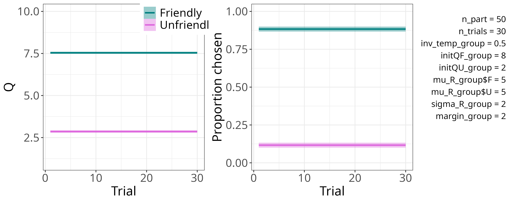
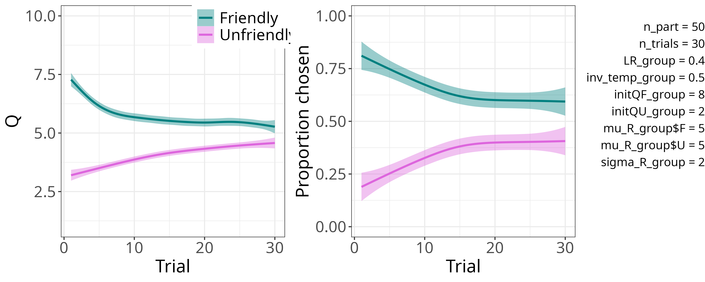
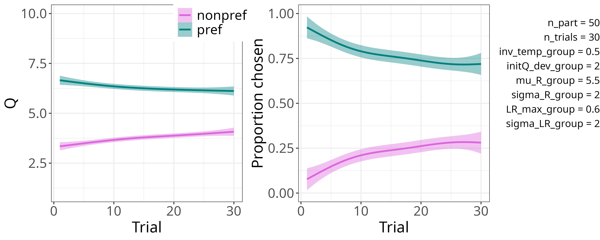

> In this document I inspect parameter recovery results. More specifically, I first look at the results of a single run of the simulation and fitting (where parameter settings are chosen by me), and then at many runs (where parameter settings are generated randomly).

```{r doc-setup, include = FALSE}
knitr::opts_chunk$set(echo = TRUE)
knitr::opts_chunk$set(message = FALSE)
knitr::opts_chunk$set(fig.width = 10, fig.height = 8)
```

```{r r-setup}
rm(list = ls())
main_dir <- "~/research/climate-RL-mod/"
util_dir <- paste0(main_dir, "9_utilities/")
mod_dir <- paste0(main_dir, "0_models/")
recov_dir <- paste0(main_dir, "3_param_recovery/")

sim_utils <- new.env()
source(paste0(util_dir, "sim_utils.R"), local = sim_utils)
plot <- new.env()
source(paste0(util_dir, "plot_utils.R"), local = plot)
fitting <- new.env()
source(paste0(util_dir, "fit_utils.R"), local = fitting)
util <- new.env()
source(paste0(util_dir, "utils.R"), local = util)
```

# `0_nolearning`
## Simulation behavior


## Many runs (random parameter settings)
```{r 0-many, fig.height = 6}
n_runs <- 100

dat_dir <- paste0(recov_dir, "0_nolearning", "/100_runs/")

free_params <- c("inv_temp_group", "initQ_dev_group")

sim_params <- data.frame(k = 1:n_runs)
fit_params <- data.frame(k = 1:n_runs)

for (k in 1:n_runs) {
  sim_file <- paste0(dat_dir, "param_settings_", sprintf("%03d", k), ".json")
  sim_dat <- rjson::fromJSON(file = sim_file)

  fit_file <- paste0(dat_dir, "draws_", sprintf("%03d", k), ".rds")
  fit_dat <- readRDS(fit_file)

  for (p in free_params) {
    sim_params[[p]][k] <- sim_dat[[p]]
    fit_params[[p]][k] <- median(fit_dat[[p]])
  }
}

plot$many_runs_param_fit(sim_params, fit_params, free_params)
```

# `1_std`
## Simulation behavior


## Many runs (random parameter settings)
```{r 1-many}
n_runs <- 100

dat_dir <- paste0(recov_dir, "1_std", "/100_runs/")

free_params <- c("LR_group", "inv_temp_group", "initQ_dev_group")

sim_params <- data.frame(k = 1:n_runs)
fit_params <- data.frame(k = 1:n_runs)

for (k in 1:n_runs) {
  sim_file <- paste0(dat_dir, "param_settings_", sprintf("%03d", k), ".json")
  sim_dat <- rjson::fromJSON(file = sim_file)

  fit_file <- paste0(dat_dir, "draws_", sprintf("%03d", k), ".rds")
  fit_dat <- readRDS(fit_file)

  for (p in free_params) {
    sim_params[[p]][k] <- sim_dat[[p]]
    fit_params[[p]][k] <- median(fit_dat[[p]])
  }
}

plot$many_runs_param_fit(sim_params, fit_params, free_params)
```

# `2_LRN_gauss`
## Simulation behavior


## Many runs (random parameter settings)
```{r 2-many}
n_runs <- 100

dat_dir <- paste0(recov_dir, "2_LRN_gauss", "/100_runs/")

free_params <- c("LR_max_group", "sigma_LR_group", "inv_temp_group", "initQ_dev_group")

sim_params <- data.frame(k = 1:n_runs)
fit_params <- data.frame(k = 1:n_runs)

for (k in 1:n_runs) {
  sim_file <- paste0(dat_dir, "param_settings_", sprintf("%03d", k), ".json")
  sim_dat <- rjson::fromJSON(file = sim_file)

  fit_file <- paste0(dat_dir, "draws_", sprintf("%03d", k), ".rds")
  fit_dat <- readRDS(fit_file)

  for (p in free_params) {
    sim_params[[p]][k] <- sim_dat[[p]]
    fit_params[[p]][k] <- median(fit_dat[[p]])
  }
}

plot$many_runs_param_fit(sim_params, fit_params, free_params)
```
